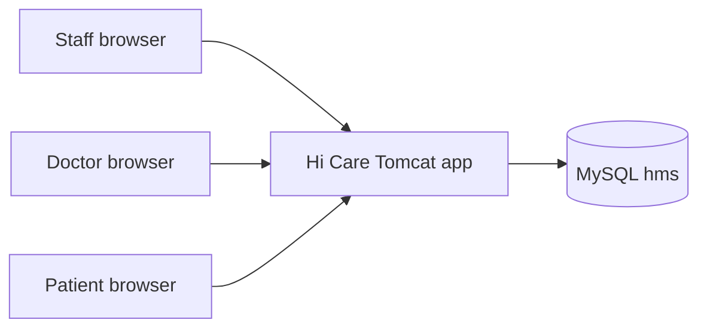
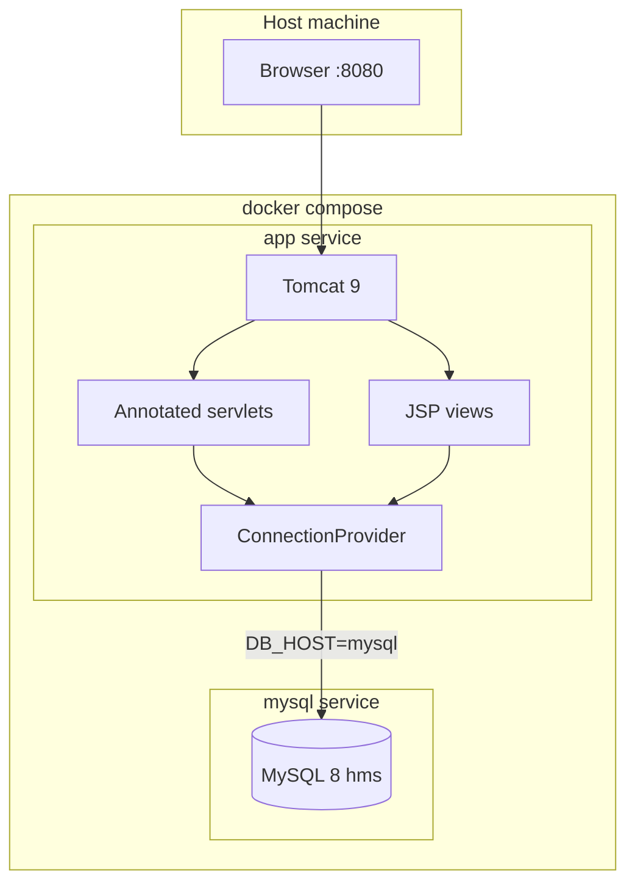
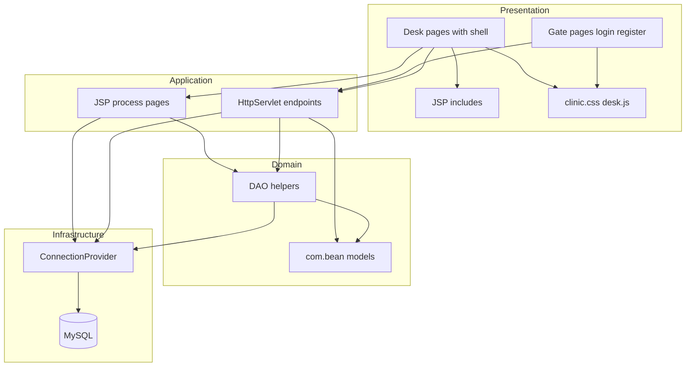

# Architecture

[Documentation home](README.md) · [Components](components.md) · [Flows](flows.md) · [Database](database.md)

## Overview

Hi Care is a classic **Java EE web application** (Servlet 3.0 + JSP) deployed on **Apache Tomcat 9**. Persistence uses **MySQL 8** through JDBC. There is no Spring Boot or Maven runtime; the Docker image compiles `src/` with `javac` and serves `WebContent/` as the `ROOT` webapp.

## System context

Three actor roles share one application, with separate login entry points and session-scoped navigation:

| Role | Login page | Post-login landing |
|------|------------|--------------------|
| Staff (admin user) | `index.jsp` → `/LoginDao` | `department.jsp` |
| Doctor | `doctorLogin.jsp` → `/DoctorLogin` | `afterDoctorLogin.jsp` |
| Patient | `patientLogin.jsp` → `/PatientLogin` | `afterPatientLogin.jsp` |

## Deployment architecture

- **mysql**: image `mysql:8.0`, database `hms`, dumps mounted from [`database/hospital_db`](../database/hospital_db) into `/docker-entrypoint-initdb.d`.
- **app**: built from [`Dockerfile`](../Dockerfile); env vars `DB_HOST`, `DB_PORT`, `DB_NAME`, `DB_USER`, `DB_PASSWORD` configure JDBC.

## Application layers

| Layer | Location | Responsibility |
|-------|----------|----------------|
| Presentation | `WebContent/*.jsp`, `includes/`, `css/`, `js/` | Forms, tables, shell chrome |
| Application | `src/com/*` servlets, `*Process.jsp` | HTTP handling, redirects |
| Domain | `src/com/bean`, `*Dao.java` | Models and data access helpers |
| Infrastructure | `ConnectionProvider`, Docker, MySQL | Connections and runtime |

## Technology stack (actual)

| Concern | Choice |
|---------|--------|
| Language | Java 17 |
| Web API | `javax.servlet` (Tomcat 9) |
| Views | JSP + static CSS/JS |
| Database | MySQL 8 |
| Driver | `mysql-connector-j` 8.0.33 |
| Packaging | Docker Compose (no Maven/Spring in this tree) |

## Related

- [Components](components.md) — packages and servlet catalog  
- [Deployment](deployment.md) — runbooks and env vars  
- [Database](database.md) — schema details  
