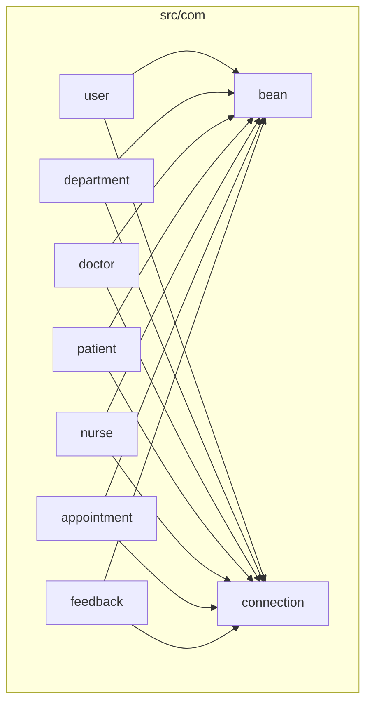
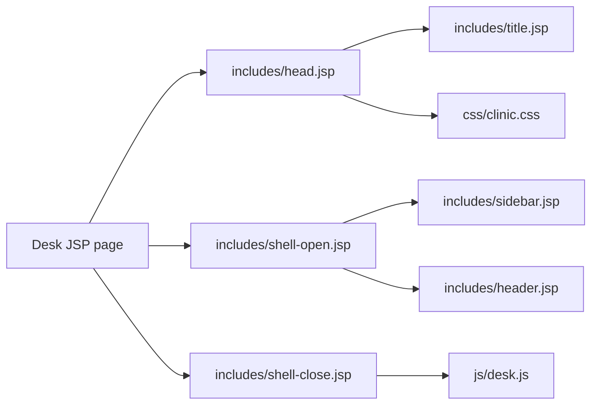
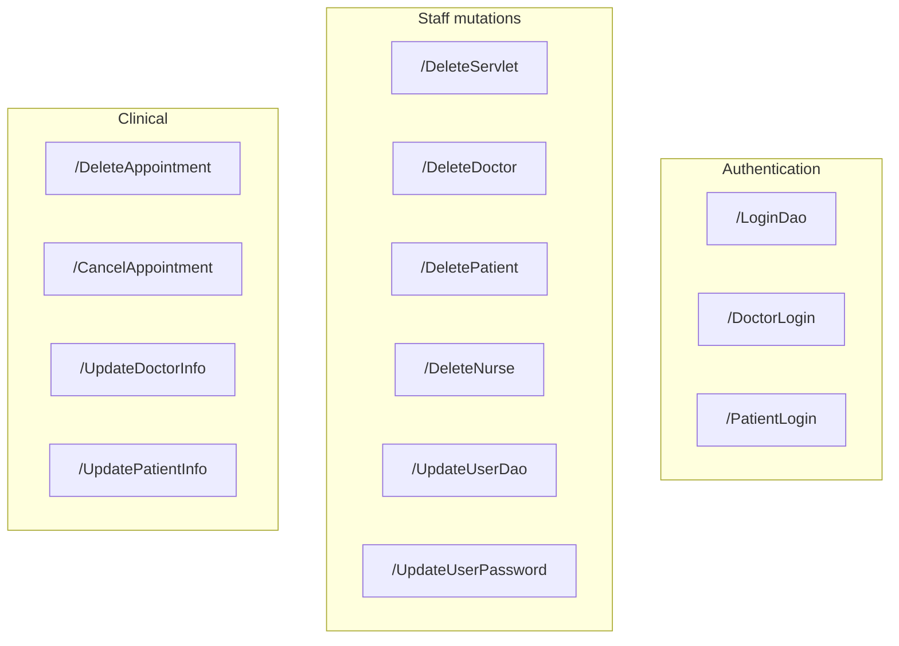

# Components

[Documentation home](README.md) · [Architecture](architecture.md) · [Flows](flows.md) · [Frontend](frontend.md)

## Java package map

| Package | Role |
|---------|------|
| `com.bean` | POJOs: `User`, `Department`, `Doctor`, `Patient`, `Nurse`, `Appointment`, `Feedback` |
| `com.connection` | `ConnectionProvider` — JDBC with env-based config and reconnect |
| `com.user` | Staff login, register, profile, password update |
| `com.department` | Department DAO, add/edit helpers, delete servlet |
| `com.doctor` | Doctor CRUD helpers, login, delete |
| `com.patient` | Patient CRUD helpers, login, delete |
| `com.nurse` | Nurse CRUD helpers, delete |
| `com.appointment` | Book/cancel/delete appointment; doctor/patient profile update servlets |
| `com.feedback` | Add feedback helper |

## UI shell components

| Partial | Responsibility |
|---------|----------------|
| `title.jsp` | Resolves section title from URI into `pageTitle` |
| `head.jsp` | HTML head, favicon, tab title `{section} · Hi Care` |
| `shell-open.jsp` | Opens `.shell`, includes sidebar + header |
| `sidebar.jsp` | Role nav (`staff` / `doctor` / `patient`) + Profile / Sign out |
| `header.jsp` | Top bar title + signed-in name |
| `shell-close.jsp` | Closes shell, loads `desk.js` |

Request attributes set by each desk page before includes:

- `nav` — `staff` \| `doctor` \| `patient`
- `profileHref` — role-specific profile page

## Servlet catalog

Annotated with `@WebServlet` (no entries required in `web.xml` beyond welcome file).

| Endpoint | Class | Typical caller |
|----------|-------|----------------|
| `/LoginDao` | `com.user.LoginDao` | `index.jsp` |
| `/DoctorLogin` | `com.doctor.DoctorLogin` | `doctorLogin.jsp` |
| `/PatientLogin` | `com.patient.PatientLogin` | `patientLogin.jsp` |
| `/DeleteServlet` | `com.department.DeleteServlet` | `department.jsp` |
| `/DeleteDoctor` | `com.doctor.DeleteDoctor` | `doctor.jsp` |
| `/DeletePatient` | `com.patient.DeletePatient` | `patients.jsp` |
| `/DeleteNurse` | `com.nurse.DeleteNurse` | `nurse.jsp` |
| `/UpdateUserDao` | `com.user.UpdateUserDao` | `profile.jsp` |
| `/UpdateUserPassword` | `com.user.UpdateUserPassword` | `profile.jsp` |
| `/UpdateDoctorInfo` | `com.appointment.UpdateDoctorInfo` | `UpdateDoctorProfile.jsp` |
| `/UpdatePatientInfo` | `com.appointment.UpdatePatientInfo` | `updatePatientProfile.jsp` |
| `/DeleteAppointment` | `com.appointment.DeleteAppointment` | `afterDoctorLogin.jsp` |
| `/CancelAppointment` | `com.appointment.CancelAppointment` | `viewAppointment.jsp` |

## Process JSP components

Create/update paths often use a thin JSP that binds a bean and redirects (not a servlet):

| Process page | Domain action | Redirect target |
|--------------|---------------|-----------------|
| `process.jsp` | `RegisterDao.register` | success/fail gate UI |
| `departmentProcess.jsp` | add department | `department.jsp` |
| `doctorProcess.jsp` | add doctor | `doctor.jsp` |
| `patientProcess.jsp` | add patient | `patients.jsp` |
| `nurseProcess.jsp` | add nurse | `nurse.jsp` |
| `appointmentProcess.jsp` | book appointment | `afterPatientLogin.jsp` |
| `feedbackProcess.jsp` | add feedback | `feedback.jsp` |
| `editDept.jsp` / `editDoc.jsp` / `editNur.jsp` / `editPatie.jsp` | update entity | list page |

## Connection component

`com.connection.ConnectionProvider`:

- Reads `DB_HOST`, `DB_PORT`, `DB_NAME`, `DB_USER`, `DB_PASSWORD` (defaults for local `root` / `bilz999` / `hms`)
- Uses `com.mysql.cj.jdbc.Driver`
- Validates the connection and retries a few times (useful when MySQL is still starting)

## Related

- [Flows](flows.md) — how these components collaborate  
- [Frontend](frontend.md) — page inventory and theming  
