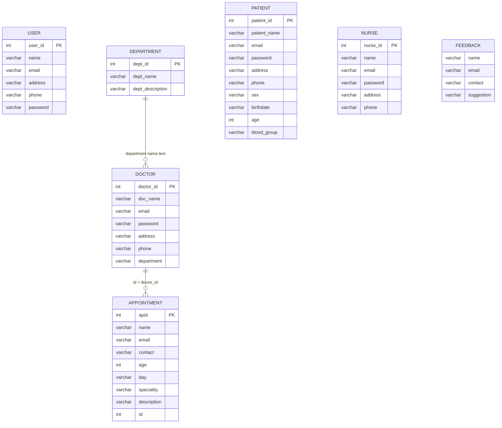
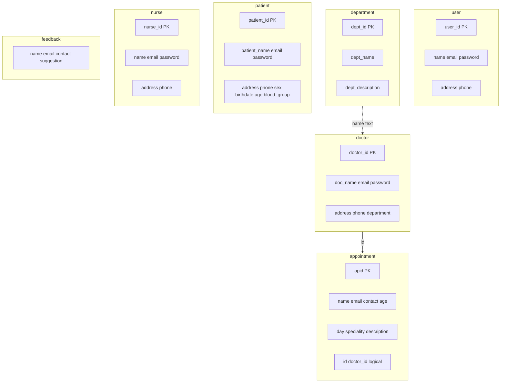

# Database

[Documentation home](README.md) · [Architecture](architecture.md) · [Flows](flows.md)

## Overview

- **Engine:** MySQL 8  
- **Database name:** `hms`  
- **Init scripts:** [`database/hospital_db/`](../database/hospital_db) (loaded once into a fresh Docker volume)  
- **Foreign keys:** none declared in the dumps; relationships are logical only  

## Entity relationship (logical)



Notes:

- `doctor.department` stores a **department name string**, not `dept_id`.
- `appointment.id` stores the **doctor id**, not a separate FK column name.
- `feedback` has **no primary key**.

## Table catalog

### `user` — staff accounts

Source: [`hms_user.sql`](../database/hospital_db/hms_user.sql)

| Column | Type | Notes |
|--------|------|-------|
| `user_id` | int AI PK | |
| `name` | varchar(100) | Session display name |
| `email` | varchar(100) | Login key |
| `address` | varchar(400) | |
| `phone` | varchar(200) | |
| `password` | varchar(100) | Stored in plain text in seed data |

### `department`

Source: [`hms_department.sql`](../database/hospital_db/hms_department.sql)

| Column | Type | Notes |
|--------|------|-------|
| `dept_id` | int AI PK | |
| `dept_name` | varchar(100) | |
| `dept_description` | varchar(400) | |

### `doctor`

Source: [`hms_doctor.sql`](../database/hospital_db/hms_doctor.sql)

| Column | Type | Notes |
|--------|------|-------|
| `doctor_id` | int AI PK | |
| `doc_name` | varchar(100) | |
| `email` | varchar(100) | Login |
| `password` | varchar(100) | |
| `address` | varchar(400) | |
| `phone` | varchar(100) | |
| `department` | varchar(100) | Free-text specialty/department |

### `patient`

Source: [`hms_patient.sql`](../database/hospital_db/hms_patient.sql)

| Column | Type | Notes |
|--------|------|-------|
| `patient_id` | int AI PK | |
| `patient_name` | varchar(100) | |
| `email` | varchar(100) | Login |
| `password` | varchar(100) | |
| `address` | varchar(400) | |
| `phone` | varchar(100) | |
| `sex` | varchar(45) | |
| `birthdate` | varchar(100) | |
| `age` | int | |
| `blood_group` | varchar(45) | |

### `nurse`

Source: [`hms_nurse.sql`](../database/hospital_db/hms_nurse.sql)

| Column | Type | Notes |
|--------|------|-------|
| `nurse_id` | int AI PK | |
| `name` | varchar(45) | |
| `email` | varchar(100) | |
| `password` | varchar(100) | |
| `address` | varchar(400) | |
| `phone` | varchar(100) | |

### `appointment`

Source: [`hms_appointment.sql`](../database/hospital_db/hms_appointment.sql)

| Column | Type | Notes |
|--------|------|-------|
| `apid` | int AI PK | |
| `name` | varchar(50) | Patient display name on booking |
| `email` | varchar(130) | |
| `contact` | varchar(130) | |
| `age` | int | |
| `day` | varchar(130) | Date string |
| `speciality` | varchar(130) | |
| `description` | varchar(200) | |
| `id` | int | **Doctor id** (logical FK to `doctor.doctor_id`) |

### `feedback`

Source: [`hms_feedback.sql`](../database/hospital_db/hms_feedback.sql)

| Column | Type | Notes |
|--------|------|-------|
| `name` | varchar(100) | No PK |
| `email` | varchar(100) | |
| `contact` | varchar(200) | |
| `suggestion` | varchar(400) | |

## Schema diagram (columns)



## Access patterns by role

| Role | Tables read/written |
|------|---------------------|
| Staff | `user`, `department`, `doctor`, `patient`, `nurse`, `feedback` |
| Doctor | `doctor`, `appointment` (filter `id = session.doctor_id`) |
| Patient | `patient`, `doctor` (list), `appointment`, `feedback` |

## Resetting data (Docker)

Deleting the named volume forces re-import of dumps on next start:

```bash
docker compose down -v
docker compose up --build
```

## Related

- [Deployment](deployment.md) — connection env vars  
- [Flows](flows.md) — which operations hit which tables  
