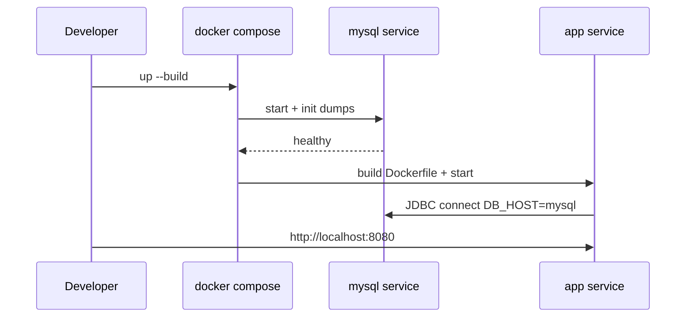

# Deployment

[Documentation home](README.md) · [Architecture](architecture.md) · [Database](database.md)

## Prerequisites

- Docker Desktop (or Docker Engine + Compose v2)
- Host ports **8080** (HTTP) and **3306** (MySQL) free, or change mappings in [`docker-compose.yml`](../docker-compose.yml)

## Run with Docker Compose

```bash
docker compose up --build
```



Stop:

```bash
docker compose down
```

Reset database (re-import dumps):

```bash
docker compose down -v
docker compose up --build
```

## Environment variables

Set on the **app** service (see [`docker-compose.yml`](../docker-compose.yml)):

| Variable | Default in Compose | Purpose |
|----------|--------------------|---------|
| `DB_HOST` | `mysql` | JDBC host |
| `DB_PORT` | `3306` | JDBC port |
| `DB_NAME` | `hms` | Database name |
| `DB_USER` | `root` | DB user |
| `DB_PASSWORD` | `bilz999` | DB password |

MySQL service:

| Variable | Value |
|----------|-------|
| `MYSQL_ROOT_PASSWORD` | `bilz999` |
| `MYSQL_DATABASE` | `hms` |

## Image build steps

[`Dockerfile`](../Dockerfile):

1. Base: `tomcat:9.0-jdk17-temurin`
2. Copy `WebContent/` → `/usr/local/tomcat/webapps/ROOT/`
3. Download MySQL Connector/J into `WEB-INF/lib`
4. Compile `src/**/*.java` into `WEB-INF/classes`
5. Expose `8080`

## Local IDE run (optional)

Without Docker:

1. MySQL 8 with database `hms`; import files under `database/hospital_db/`
2. JDK 17 + Tomcat 9
3. Deploy `WebContent` as the web root; compile `src` to `WEB-INF/classes`
4. Add MySQL Connector/J to `WEB-INF/lib`
5. Align `ConnectionProvider` env/defaults with your MySQL credentials

## Sample accounts (seed data)

| Role | Email | Password |
|------|-------|----------|
| Staff | `kumudu@gmail.com` | `admin@123` |
| Doctor | `sunil@yahoomail.com` | `sunil@123` |
| Patient | `kumari329@yahoo.com` | `123@123` |

Passwords in the seed dumps are stored in plain text — suitable for demos only.

## Troubleshooting

| Symptom | Likely cause | Action |
|---------|--------------|--------|
| Port 8080 in use | Another process bound | Change `"8080:8080"` in compose or stop the other process |
| App 500 on first requests | MySQL not ready | Wait for healthcheck; app retries JDBC |
| Empty tables | Volume already initialized with empty/old data | `docker compose down -v` then up |
| JSP compile “Duplicate local variable” | Static include name clash | Avoid redeclaring vars already set in included JSPs |

## Related

- [Architecture](architecture.md) — deployment diagram  
- [Database](database.md) — schema and reset notes  
