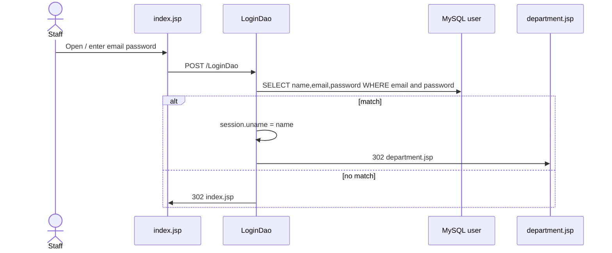
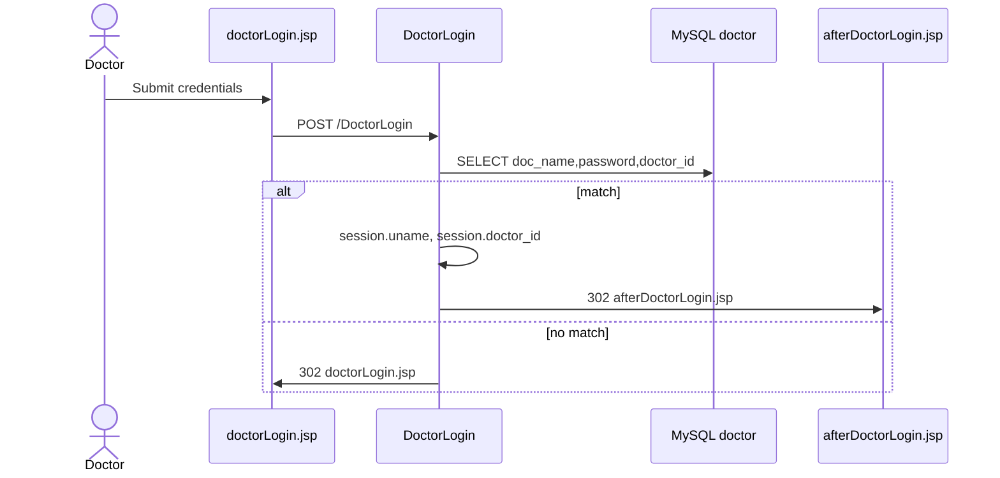
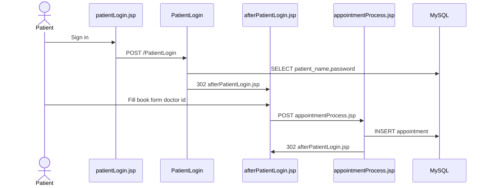
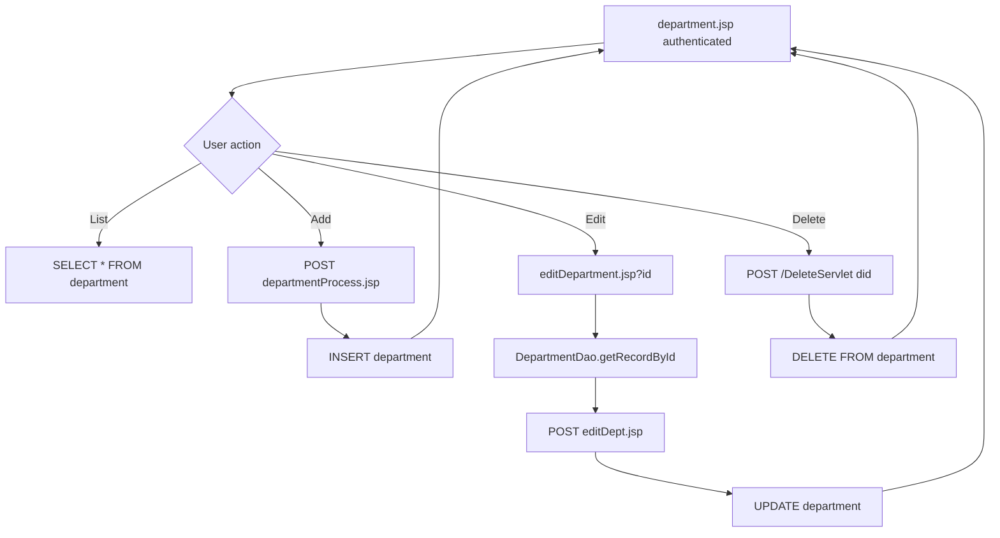
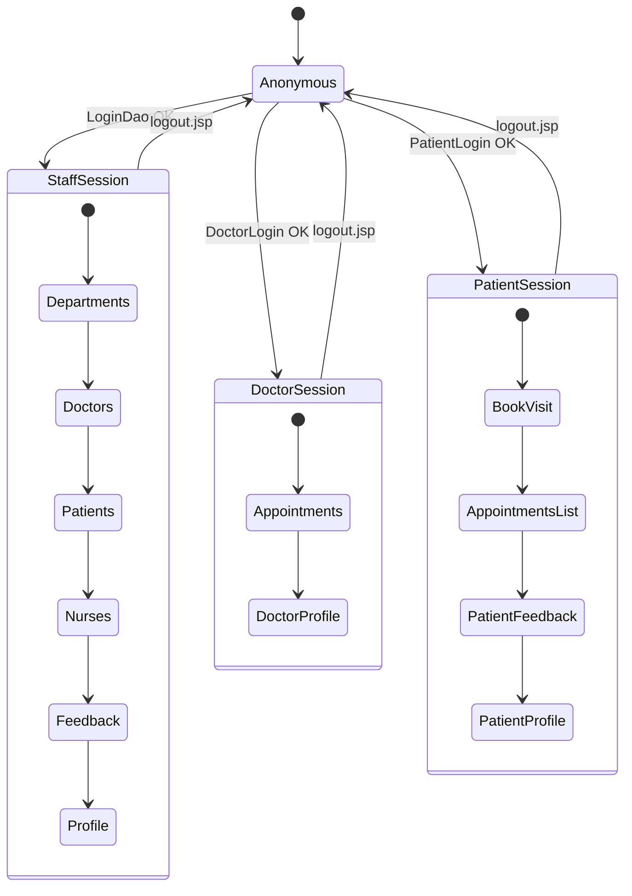
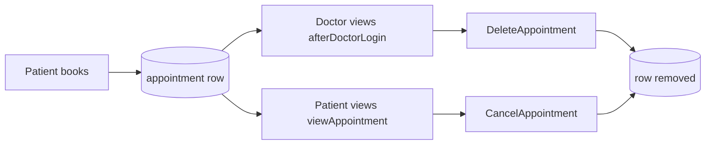

# Flows

[Documentation home](README.md) · [Architecture](architecture.md) · [Components](components.md) · [Database](database.md)

## Staff authentication

## Doctor authentication

## Patient authentication and booking

## Staff CRUD (department example)

The same pattern applies to doctors, patients, and nurses with their list pages, process JSPs, edit pages, and delete servlets.

## Session and navigation

Unauthenticated access to desk pages redirects to the role’s login page (`index.jsp`, `doctorLogin.jsp`, or `patientLogin.jsp`).

## Appointment lifecycle

Logical link: `appointment.id` stores the doctor’s `doctor_id` (no database foreign key).

## Related

- [Database](database.md) — tables touched by these flows  
- [Components](components.md) — servlet and process page names  
