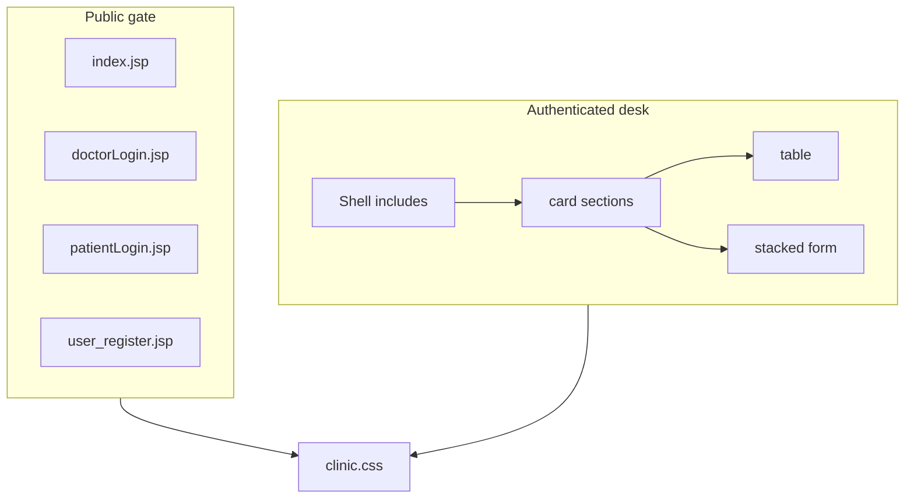

# Frontend

[Documentation home](README.md) · [Components](components.md) · [Flows](flows.md)

## Design system

Styles live in [`WebContent/css/clinic.css`](../WebContent/css/clinic.css) using CSS variables and BEM-style blocks (`shell__*`, `card__*`, `form__*`, `gate__*`).

| Token | Role | Example |
|-------|------|---------|
| `--clinic-primary` | Brand / focus | `#2563EB` |
| `--clinic-accent` | Primary actions | `#10B981` |
| `--clinic-bg` | App background | `#F9FAFB` |
| `--clinic-surface` | Cards / sidebar | `#FFFFFF` |
| `--clinic-text` | Body text | `#1E293B` |

Client behavior (`tabs`, current nav highlight) is in [`WebContent/js/desk.js`](../WebContent/js/desk.js).

## Page composition

### Titles

| Surface | Source | Example |
|---------|--------|---------|
| Browser tab | `includes/title.jsp` + `head.jsp` | `Departments · Hi Care` |
| Top bar | `includes/header.jsp` | `Departments` |
| Sidebar brand | `includes/sidebar.jsp` + `images/logo.png` | Logo + Hi Care |

### Images

| Asset | Usage |
|-------|--------|
| `images/logo.png` | Favicon, sidebar mark, gate brand |
| `images/bg.jpg`, `bg3.jpg`, `bgcontent.jpg` | Legacy backgrounds — not used by the clinical theme |
| `images/confirmation-tick.png` | Legacy success graphic — unused |

## Desk page inventory

### Staff (`nav=staff`)

| Page | Purpose |
|------|---------|
| `department.jsp` | List / add departments |
| `editDepartment.jsp` | Edit department |
| `doctor.jsp` | List / add doctors |
| `editDoctor.jsp` | Edit doctor |
| `patients.jsp` | List / add patients |
| `editPatients.jsp` | Edit patient |
| `nurse.jsp` | List / add nurses |
| `editNurse.jsp` | Edit nurse |
| `viewFeedback.jsp` | Read feedback |
| `profile.jsp` | Staff profile + password |

### Doctor (`nav=doctor`)

| Page | Purpose |
|------|---------|
| `afterDoctorLogin.jsp` | Appointments for `session.doctor_id` |
| `UpdateDoctorProfile.jsp` | Doctor profile |

### Patient (`nav=patient`)

| Page | Purpose |
|------|---------|
| `afterPatientLogin.jsp` | Doctor list + book visit |
| `viewAppointment.jsp` | Appointments + cancel |
| `feedback.jsp` | Submit feedback |
| `updatePatientProfile.jsp` | Patient profile |

## Accessibility notes

- Visible focus rings via `:focus-visible`
- `prefers-reduced-motion` respected for transitions
- Action buttons keep text labels plus optional SVG icons (no dependency on Glyphicons)

## Related

- [Components](components.md) — include graph  
- [Deployment](deployment.md) — how static assets are packaged  
